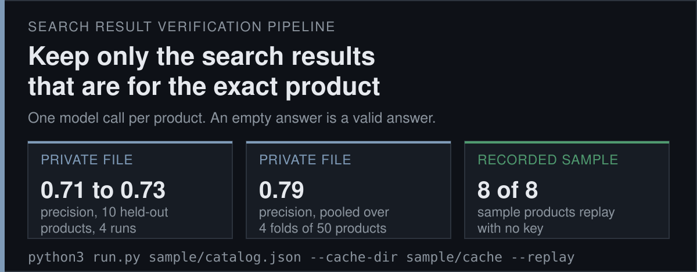
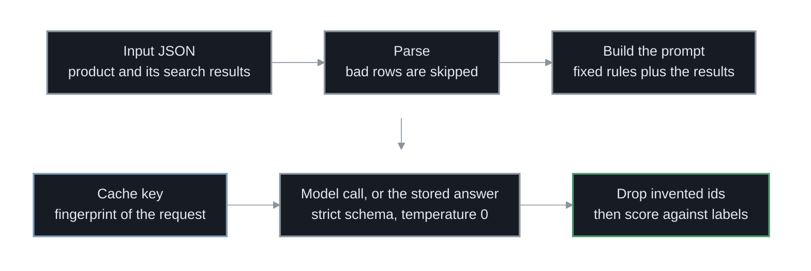
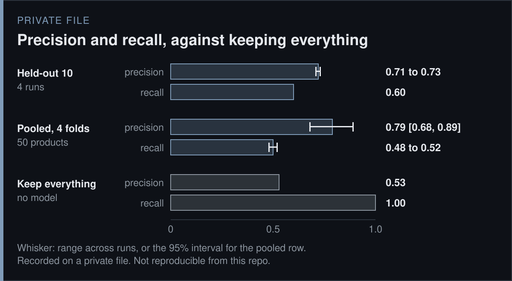
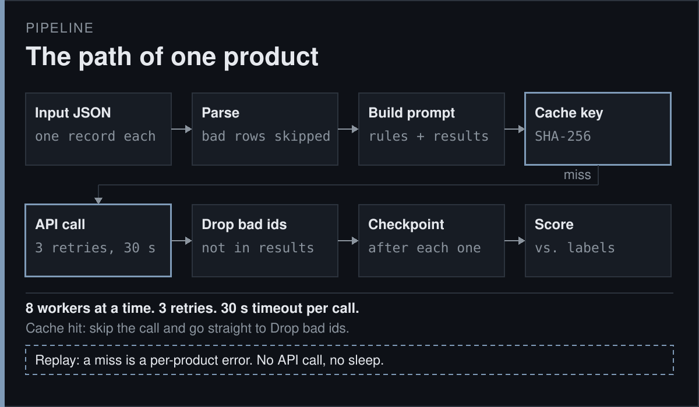

<p align="center">
<a href="https://github.com/jameswniu/llm-search-result-verification-pipeline/actions/workflows/gates.yml"></a>


</p>

<p align="center"><code>input -> parse -> prompt -> cache -> model -> filter -> score</code></p>

This repo is a pipeline that checks web search results. Given a product and the results a search returned for it, it keeps only the results that are for that exact product. An empty list is a valid answer. Under the rules, a different pack size of the same product still counts, and a different flavor does not.

It makes one model call per product at temperature 0, the setting that asks for the same answer every time, with a strict JSON schema, which fixes the answer format. Any result id the model invents is dropped. Answers are stored under a cache key, a fingerprint of everything that could change them, so a rerun is free and identical.

The numbers on this page come from two places and are tagged. PRIVATE FILE numbers were measured on a private 50-product labeled file that is not distributed. SCRIPTED SAMPLE numbers come from a replay of 8 invented products whose answers are written by hand, so no model produced them.




## Results



Every number in this list was measured on the private file, except the last bullet, which is the scripted sample.

- **Held-out precision:** Of the results it picked, 0.71 to 0.73 were right on 10 products set aside before any prompt was written, across 4 runs. Recall, the share of the right results it found, was 0.60.
- **Pooled over folds:** A fold is one quarter of the data. The rules were refit on three quarters and scored on the fourth, so no product was scored by a prompt that saw its label. Precision was 0.79 with a 95% interval of [0.68, 0.89], and recall 0.48 to 0.52.
- **The baseline:** Keeping every result scores 0.53 precision and 1.00 recall, since 240 of 455 results were right. The low end of the interval, 0.68, is above it.
- **All 50 products:** Precision 0.78 to 0.80 and recall 0.56. 40 of the 50 products were read while writing the rules, so this measures fit and not generalization.
- **Cost:** About $24 per 100,000 products, estimated from recorded token counts at list prices. The count is 352 recorded calls, 558,143 input tokens and 4,019 output tokens.
- **The scripted run:** It prints precision 0.95 and recall 1.00 on 8 products, with one invented id dropped and one near miss kept. It says nothing about a model.



## What this page cannot show you

- **Private numbers:** Every PRIVATE FILE number is recorded, and cannot be reproduced from this repo because the labeled file is private. The referee cards in [`docs/REFEREE.md`](docs/REFEREE.md) say how each was counted.
- **The sample:** Its answers are written by hand, six exact and two imperfect on purpose. It shows how a run reads input, validates an answer and scores it. It is not model output and not a benchmark.
- **Sample size:** Ten held-out products is small, and the pooled interval is wide. Temperature 0 is not perfectly stable, so each number is a range across repeated runs.
- **Cross-validation:** `cross_validate.py` refits the rules per fold. It needs a key and the private file, so it has no replay.
- **Known limits:** The known weaknesses are written down in `DECISIONS.md`.
- **Not measured:** Other models, other product types, and the search step itself.

## Quick start

```bash
git clone https://github.com/jameswniu/llm-search-result-verification-pipeline.git
cd llm-search-result-verification-pipeline
python3 run.py sample/catalog.json --cache-dir sample/cache --replay --output output.json
```

It prints a progress line per product and ends with this summary, in under a second:

```
== Run summary, replayed (8 products, 0 errors) ==
Replay: 8 hits, 0 misses
Latency: n/a (replayed)
Answers: 8 scripted by hand, no model was called, so there is no cost
Dropped ids (not among a product's results): 1

== Scripted answers vs. labels (no model was called) (8 products) ==
Precision:            0.947  (tp=18, fp=1)
Recall:               1.000  (tp=18, fn=0)
Product contamination: 0.125  (1/8 products picked up >=1 wrong site)
Product coverage:      1.000  (6/6 products with a trusted label got >=1 right site)
Exact-set agreement:   0.875  (7/8 products matched the label set exactly)

Disagreements (1 products):
  'FizzWell Cola Zero Sugar 12 fl oz can': predicted=[1, 2, 5, 6] truth=[1, 2, 6] fp=[5] fn=[]
```

> Tested on Python 3.12 and 3.14. It needs no key, no installed package and no network, and `output.json` is ignored by git. Tests are a second block that needs `pip install -r requirements.txt`.

```bash
python3 -m venv .venv && . .venv/bin/activate && pip install -r requirements.txt
python3 -m pytest -q
```

## Point it at your own data

The input is a JSON object of key to record. Each record has `product_title`, an optional `product_description`, and `search_results`, a numbered object of `Title`, `Link` and `Snippet` text. Add `trusted_search_results`, the correct ids, to get a score. [`sample/README.md`](sample/README.md) shows the shape.

```bash
export OPENAI_API_KEY=...
python3 run.py your_products.json --output output.json
```

## What ships and what stays private

- **Ships:** The code, the tests, the sample with its scripted answers, and the referee cards with every number.
- **Stays private:** The 50-product labeled file and the model answers recorded on it.
- **Why:** The file belongs to its owner. The page keeps the measured numbers and says where they came from.

## Files

| Path | What it holds |
|---|---|
| `src/parsing.py` | JSON to typed records |
| `src/prompts.py` | Prompt scaffold, rules block and output schema |
| `src/cache.py` | Disk cache, with a read-only mode for replay |
| `src/selector.py` | One product in, one result out: call, retries, id check, cost |
| `src/pipeline.py` | Many products: concurrency, checkpoint, writer, run summary |
| `src/metrics.py` | Scoring |
| `run.py` | The command line |
| `cross_validate.py` | Four-fold cross-validation, rule synthesis and bootstrap |
| `sample/` | Eight invented products, their scripted answers and the built cache |
| `tools/` | Facts, figure generators, README and replay checks, and the demo tape |
| `tests/` | 51 tests, no network |
| `docs/REFEREE.md` | The card behind every private-file number |
| `DECISIONS.md` | What was cut, designed and fixed, and why |
| `media/` | The three figures and the demo recording |
| `LICENSE` | Apache-2.0 |

## License

Apache-2.0, see [`LICENSE`](LICENSE).
